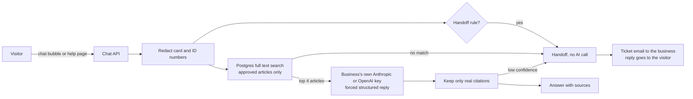

# CiteDesk

**An AI support assistant for small businesses. It answers only from your own website and documents, cites every source, and hands hard questions to a person. Businesses bring their own AI key, so there is no AI markup.**

**Live:** https://citedesk-app.vercel.app · **Sample bot:** [/demo](https://citedesk-app.vercel.app/demo) · **License:** AGPL 3.0
**Status:** Phase 1 built (free pilot for small businesses). CiteDesk grew out of the [Ledgerly Support Agent](https://github.com/OluwafemiPaul/ai-support-agent) prototype.

[](https://vercel.com/new/clone?repository-url=https%3A%2F%2Fgithub.com%2FOluwafemiPaul%2Fcitedesk&project-name=citedesk&repository-name=citedesk&env=NEXT_PUBLIC_SUPABASE_URL,NEXT_PUBLIC_SUPABASE_PUBLISHABLE_KEY,SUPABASE_SECRET_KEY,ENCRYPTION_KEY,NEXT_PUBLIC_SITE_URL&envDescription=Supabase%20URL%20and%20keys%2C%20a%2064%20character%20hex%20encryption%20key%2C%20and%20your%20site%20address.%20See%20the%20README.&envLink=https%3A%2F%2Fgithub.com%2FOluwafemiPaul%2Fcitedesk%23deploy-your-own-copy)

## What it does

* **Answers from your content only.** Import your website, upload PDF and Word files, or write articles. Every answer links to its sources.
* **Hands off to a person** for fraud, account problems, legal threats, requests for a human, topics you choose, or any answer it is not sure about. The visitor leaves an email, and your team gets a ticket with the full conversation; replying to it answers the customer.
* **One line of code** adds a chat bubble to Wix, Squarespace, Shopify, WordPress, Webflow or any site. No website? Every business also gets a hosted help page.
* **Bring your own AI key** (Anthropic or OpenAI). Keys are encrypted and never shown again in full.
* **Shows what customers ask:** questions resolved, handoffs, tickets, help center gaps with one click to write the missing article, most used articles, CSV export.
* **Built for low cost hosting:** owner approval, plan limits, usage alerts and pause switches, so the hosted service never runs up surprise costs.

## How it works



* **Knowledge:** website import (ownership check by meta tag, file or DNS record; sitemap then links; robots.txt; one page per second; main content extraction), PDF and Word uploads split by heading, written articles. Only approved articles are used.
* **Data isolation:** every business owned table carries an account id protected by Postgres row level security. AI keys and search chunks are readable by the server only.
* **Widget:** a 4 KB script loads after the page, fetches the bubble's look only on the business's verified domains, and opens the chat in an isolated iframe.
* **Stack:** Next.js 16, React 19, TypeScript, Tailwind CSS 4, Supabase (Postgres, Auth, row level security, full text search), Nodemailer (SMTP) or Resend, Cloudflare Turnstile, Vercel.

## Use the hosted version

[Request access](https://citedesk-app.vercel.app/request-access). A person reviews every request. After approval, the setup wizard takes about 20 minutes: connect your AI key, add knowledge, review articles, test, customize, install.

## Run it locally (about 10 minutes)

You need Node.js 20 or newer and a free [Supabase](https://supabase.com) project.

1. Clone and install:
   ```bash
   git clone https://github.com/OluwafemiPaul/citedesk.git
   cd citedesk
   npm install
   cp .env.example .env.local
   ```
2. Fill in `.env.local`: your Supabase URL and keys (Project Settings, API) and a random `ENCRYPTION_KEY` (the command is in `.env.example`). Leave `PLATFORM_OWNER_EMAIL` empty to make the first person who signs in the owner.
3. Set up the database with one command. Find `DATABASE_URL` in Supabase under **Connect**, **Session pooler**:
   ```bash
   DATABASE_URL="postgresql://..." npm run db:setup
   ```
   This runs every migration in `supabase/migrations` and adds a sample business with a help page at `/help/sample-bakery`. Add `-- --no-seed` to skip the sample. You can also paste each migration into the Supabase SQL Editor by hand.
4. In Supabase, open **Authentication, URL Configuration** and add `http://localhost:3000/auth/callback` to Redirect URLs.
5. Start it with `npm run dev`, open http://localhost:3000/login and sign in. You become the platform owner.

Without email settings or Turnstile keys, emails are printed to the terminal and the bot check is skipped, so everything still works locally.

## Deploy your own copy

1. Create a Supabase project and run `npm run db:setup` against it (step 3 above).
2. Click **Deploy with Vercel** at the top and fill in the settings it asks for. Set `NEXT_PUBLIC_SITE_URL` to your Vercel address, for example `https://your-project.vercel.app`.
3. In Supabase **Authentication, URL Configuration**, set the Site URL to your address and add `https://your-project.vercel.app/auth/callback` to Redirect URLs.
4. Paste `supabase/email-templates/sign-in.html` into Supabase **Authentication, Emails, Templates** for both **Magic link** and **Confirm signup**, so sign in emails carry a 6 digit code.
5. Optional settings:
   * Email: `SMTP_USER`, `SMTP_PASS` and `EMAIL_FROM` for Gmail or any SMTP service, or `RESEND_API_KEY` once you own a domain. Use the same details in Supabase custom SMTP so sign in emails reach everyone.
   * Turnstile bot check: `NEXT_PUBLIC_TURNSTILE_SITE_KEY` and `TURNSTILE_SECRET_KEY`.
   * Daily retention cleanup: `CRON_SECRET` (Vercel runs `/api/cron/cleanup` daily).
   * Running it just for your team? Turn on **Approve requests automatically** in the owner dashboard.

Every setting is described in [`.env.example`](.env.example).

## Limitations

* Answers come from keyword search (Postgres full text search), not embeddings, so very differently worded questions can miss. This keeps hosting free and predictable.
* Pages built entirely with JavaScript may import with little text; uploads and written articles cover those.
* Scanned PDFs (pictures of text) cannot be read yet. Uploads are limited to 4 MB per file on Vercel.
* Without your own email domain, emails come from a Gmail address and some land in spam. Businesses also see everything in their dashboard.
* Rate limits are kept in memory per server instance, which is fine at pilot scale but not across many instances.

## Case study

CiteDesk started as a prototype support agent for a fictional fintech: it answered from 21 help articles, cited sources and handed risky questions to a person. Turning it into a product meant solving the problems a real small business has: no help center (so: website import), no budget for AI markup (so: bring your own key), no developer (so: a setup wizard and one line install), and a platform owner who cannot afford surprise costs (so: approval, plan limits and alerts). The product requirements and the decisions behind them are written up in the PRD and FRD.

## Contributing

Issues and pull requests are welcome. See [CONTRIBUTING.md](CONTRIBUTING.md).

## License

[GNU AGPL v3](LICENSE). You can use, change and self host CiteDesk freely. If you offer a changed version as a service to others, you must share your changes under the same license.
